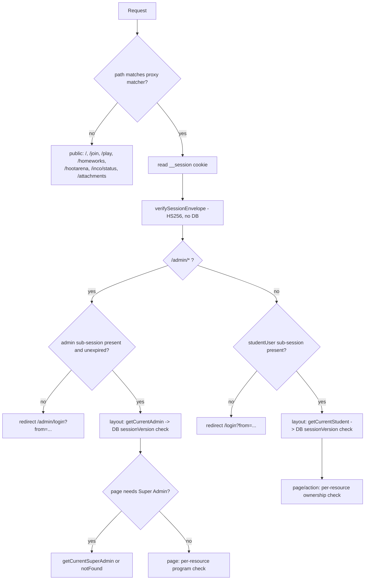

# Architecture

## Process model

One Node process does everything. `server.ts` is the entry point for both development
(`tsx watch server.ts`) and production (`cross-env NODE_ENV=production tsx server.ts`) — `next start` is
never used, because Socket.IO needs to attach to the HTTP server directly.

```
                       ┌──────────────── one Node process (tsx) ────────────────┐
                       │                                                        │
  HTTP request ───────►│  createServer(handle)  ──► Next.js request handler     │
                       │        │                      ├─ proxy.ts (middleware) │
                       │        │                      ├─ Server Components     │
                       │        │                      └─ Server Actions        │
                       │        │                                               │
  WebSocket ──────────►│  Socket.IO (path /socket.io)                           │
                       │        ├─ default namespace  ──► liveStates   Map       │
                       │        └─ /hootarena         ──► hootStates   Map       │
                       │                                                        │
                       │  rate-limit.ts  ──► hits Map                           │
                       └────────────────────────┬───────────────────────────────┘
                                                │ Prisma (pooled)
                                                ▼
                                           PostgreSQL
```

Startup order (`server.ts:1164-1173`): `app.prepare()` → build HTTP server + Socket.IO → run
`recoverLiveStates()` and `recoverHootStates()` **in parallel** → only then `httpServer.listen()`. The app
does not accept traffic until in-flight games have been rebuilt from the database.

**Three in-memory stores make this single-instance-only:** `liveStates` (server.ts:77), `hootStates`
(server.ts:137), and the rate limiter's `hits` map. Nothing is shared or persisted between processes, so a
second replica would strand students on a different process from their host. `Dockerfile` records
`--max-instances=1`.

## Request lifecycle — a student opening a quiz question

Walking `GET /quiz/abc123/q/2` end to end:

1. **`server.ts`** receives the request and passes it to Next's `handle()`.
2. **`src/proxy.ts`** matches (`matcher: ["/admin/:path*", "/dashboard/:path*", "/quiz/:path*"]`). It reads
   the raw `__session` cookie, verifies the JWT signature with `verifySessionEnvelope`, and extracts the
   `studentUser` sub-session. No database call happens here (deliberately — middleware runs on every
   request). If absent/expired → 307 redirect to `/login?from=/quiz/abc123/q/2`.
3. **`src/app/quiz/[id]/layout.tsx`** (Server Component) calls `getCurrentStudent()`, which *does* hit the
   database: it loads the `User` row and compares `user.sessionVersion` with the `sv` embedded in the
   cookie. Mismatch → redirect to `/login`. This is the revocation check the middleware cannot do.
4. **`q/[index]/page.tsx`** runs as a Server Component:
   - `getVisibleQuiz(id)` loads the homework with questions + options ordered by `order`.
   - `getAttempt(student.id, id)` — no attempt → redirect to `/quiz/[id]`; not `IN_PROGRESS` → redirect to
     `/result`. **This attempt requirement is what stops a student reading a quiz they are not eligible
     for**, since eligibility was checked when the attempt was created.
   - Index bounds are validated (`!Number.isInteger(index) || index < 0 || index >= total` → redirect).
   - `getOrCreateAttemptAnswer(attempt.id, question.id)` **upserts** the per-question row, fixing
     `deadlineAt = now + 100s` on first view and never moving it afterwards (`update: {}`).
   - `remainingSeconds(deadlineAt)` is computed **server-side** and passed down as a number.
5. **Render.** The question text and four option tiles are server-rendered. Each option is its own
   `<form>` whose action is `selectAnswer.bind(null, id, question.id, option.id)`. A small client island,
   `QuestionClientControls`, receives the server-computed remaining seconds and the tab-switch count.
6. **Answering** POSTs the Server Action `selectAnswer`. It re-derives the student from the cookie
   (`requireActiveAttempt`), re-reads `deadlineAt` from the database, and writes `selectedOptionId` **only
   if `Date.now() < deadlineAt`**. Past the deadline the write is silently skipped. Then
   `revalidatePath('/quiz/[id]/q')`.
7. **Submission** (`submitQuizAttempt`) grades everything server-side in one `$transaction`: it iterates the
   quiz's current questions, compares each stored `selectedOptionId` against that question's correct option,
   sums `score`, writes `isCorrect` per answer and flips the attempt to `COMPLETED`. Correctness is never
   computed or revealed before this point.

### Where the business logic lives
**Always on the server.** The client holds no authority at all:

| Decision | Authority | File |
|---|---|---|
| Is the session valid / revoked | `getCurrentStudent` → DB `sessionVersion` | `src/lib/session.ts:96-102` |
| May this student see this quiz | `isStudentEligibleForQuiz` | `src/lib/subjects.ts:75` |
| Has this question expired | `AttemptAnswer.deadlineAt` | `src/lib/quiz.ts:48`, re-read in `selectAnswer` |
| Tab-switch count / auto-fail | `reportTabSwitch` | `src/app/quiz/[id]/actions.ts:73` |
| Score | `submitQuizAttempt` | `src/app/quiz/[id]/actions.ts:103` |
| HootArena points | `computeHootPoints` + server clock | `server.ts:1105-1119` |

The client components (`QuizTimer`, `TabSwitchMonitor`) only *display* values the server already decided.
`QuizTimer`'s own header comment says so explicitly.

## Authentication flow



Four layers of defence, each independently sufficient for its own scope:
1. `proxy.ts` — cheap signature check, bounces unauthenticated traffic before any render.
2. Layout — re-checks the session *and* `sessionVersion` against the database.
3. Page — re-checks role and per-resource program ownership.
4. Server Action — re-checks everything again, because an action is an independently callable endpoint.

Layer 4 is the one that matters for security, and it is where the `questionId`/`answerId` IDOR bugs live
(see `SECURITY_AUDIT.md`): those actions validate the *parent* resource but then operate on an unvalidated
*child* id.

## Real-time architecture

Two fully separate Socket.IO namespaces on one server, sharing nothing but the process:

| | Legacy LIVE | HootArena |
|---|---|---|
| Namespace | default (`/`) | `/hootarena` |
| Room | `hw:{homeworkId}` | `hoot:{gameId}` |
| State map | `liveStates` | `hootStates` |
| Identity | `(studentId, clientToken)` in the join payload | `(playerId, clientToken)` in the join payload |
| Host auth | cookie → admin **or** matching `creatorToken` | cookie → admin + `canAdminManageGame` |
| Per-question clock | `question.timeLimitSec` (configurable) | fixed 20 s |
| Reconnect re-join | **missing** (bug) | implemented on `connect` |
| Leaderboard to students | full board | own score + top 3 only |

Both persist phase transitions to the database (`Homework.livePhase` / `HootGame.status` +
`currentQuestionIndex`) purely so the recovery functions can rebuild memory on boot. Neither persists the
elapsed time, so a game caught mid-`QUESTION` at restart is deliberately recovered into `REVEAL` rather
than guessing a new deadline.

## Error handling, logging, caching, background work

- **Error handling:** essentially none at the framework level. There is **no `error.tsx`,
  `global-error.tsx`, `not-found.tsx` or `loading.tsx` anywhere in `src/app`** (verified: zero files), and
  **no `try/catch` in any admin or dashboard server action**. Socket handlers do catch and
  `console.error`. So an unexpected throw renders Next's unstyled default error page.
- **Logging:** `console.log` / `console.error` only. No structured logging, no request ids, no Sentry.
- **Caching:** deliberately minimal. Almost every route is dynamic; mutations call `revalidatePath`
  explicitly. The homepage is forced dynamic (`export const dynamic = "force-dynamic"`,
  `src/app/page.tsx:11`) specifically to defeat a Firebase CDN edge-caching problem documented in that
  file. `firebase.json` also sends `no-store` for everything. Leaderboards are always computed live from
  stored rows — there are no cached totals anywhere, which is a stated design principle
  (`src/lib/scoring.ts:38`).
- **Background work:** one `setInterval` only — the rate limiter's opportunistic cleanup every 10 minutes
  (`src/lib/rate-limit.ts:27`, `.unref()`ed so it never holds the process open). Plus per-question
  `setTimeout` auto-reveal timers inside both game engines. **There is no cron, queue or scheduler**, which
  is why abandoned `IN_PROGRESS` quiz attempts are never closed out.

## Architecturally significant decisions

1. **The legacy system was never removed.** Three `Homework.mode` values coexist in one table, and
   HootArena then added its own six tables rather than a fourth mode. This keeps the old product working
   but means `Homework`, `Question`, `Option` are shared across trust boundaries — which is exactly what
   makes the legacy IDOR reach SkillArena quiz questions.
2. **One cookie, many sub-sessions.** Forced by Firebase Hosting; outlived that platform but is now
   load-bearing. Entry maps are capped at 15 to stay under the ~4 KB cookie limit.
3. **Stateless JWT + a DB version counter.** Gives revocation without a session store, at the cost of one
   `SELECT sessionVersion` per authenticated request.
4. **Server Actions instead of an API layer.** Only one route handler exists in the whole app. Consequence
   worth internalising: each action is a public endpoint, so page-level checks protect nothing.
5. **Programs/Subjects/Groups are rows, not enums.** The Super Admin can add a program or subject with no
   deploy. `Program.groupCount` is per-program (4 for Front-end, 3 for Networks) rather than a constant —
   a bug that was fixed by migration `20260921083000` after an earlier migration wrongly forced 3.
6. **No delete workflow for Program/Subject/Group**, deliberately, because deleting one would orphan or
   cascade-destroy historical attempts. The schema comments say an archive flag is the correct future
   approach.
7. **Attempt history is attributed to the quiz's program, never re-labelled** when a student changes
   program (`getCumulativeLeaderboard` doc comment, `src/lib/quiz.ts:72-93`). Nothing is deleted; past
   attempts simply stop counting toward the new program's leaderboard.
