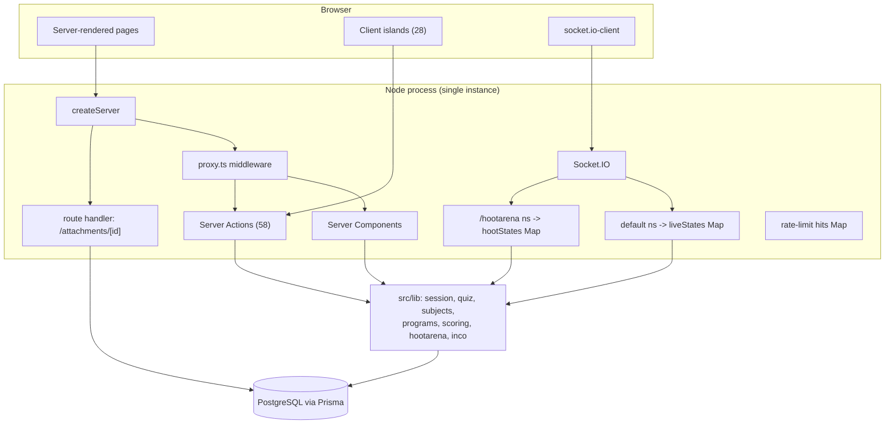
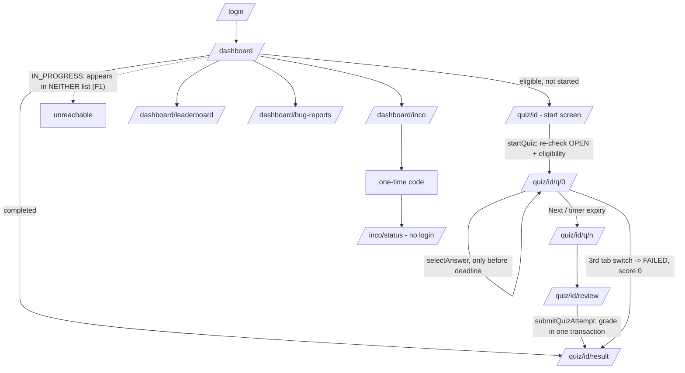
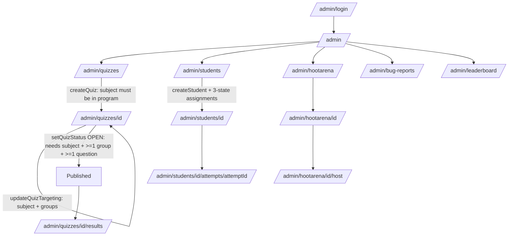
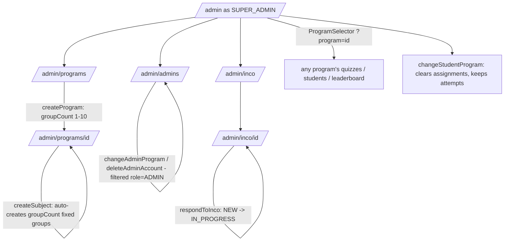
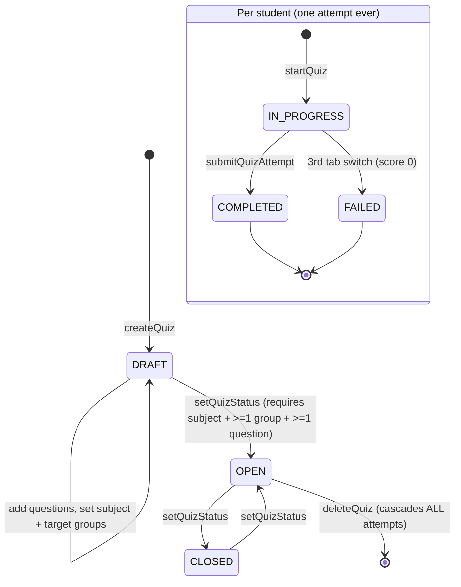
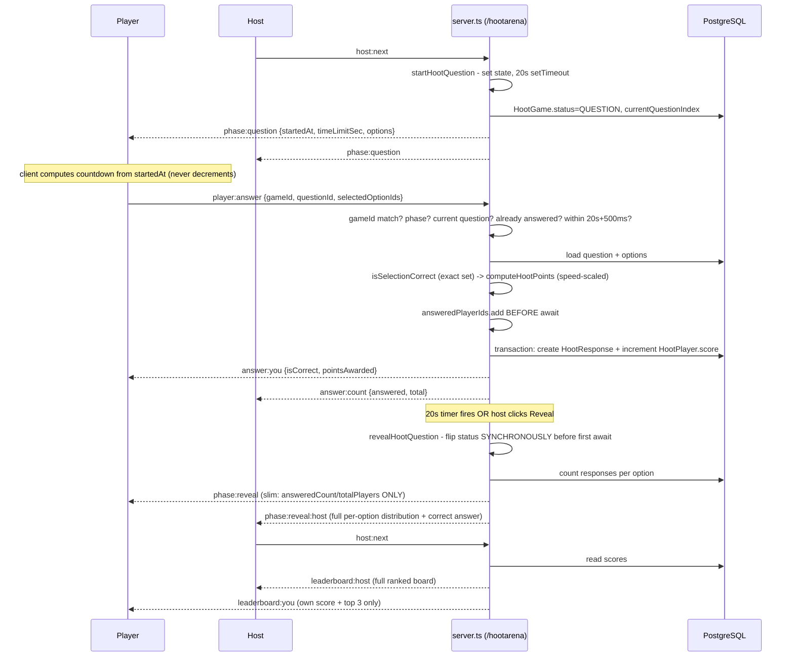

# Complete Application Map

Route table from `next build` (61 entries: 57 dynamic, 4 static).

## Route table

Auth legend: `SA` Super Admin · `A` any admin · `S` logged-in student · `tok` cookie bearer token ·
`anon` public.

### Public
| Route | Auth | Page file | Models read |
|---|---|---|---|
| `/` | anon | `app/page.tsx` (`force-dynamic`) | — |
| `/login` | anon | `app/login/page.tsx` | User (via action) |
| `/admin/login` | anon | `app/admin/login/page.tsx` | User (via action) |
| `/inco/status` | anon (**static**) | `app/inco/status/page.tsx` | IncoSubmission (via action, by hash) |
| `/attachments/[id]` | owner or any A | `app/attachments/[id]/route.ts` | BugReportAttachment, BugReport |

### Student (`proxy.ts`-gated, `getCurrentStudent` re-checked in layout)
| Route | Page file | Models |
|---|---|---|
| `/dashboard` | `dashboard/page.tsx` | User, Program, Homework, QuizAttempt, StudentSubjectGroup |
| `/dashboard/leaderboard` | `dashboard/leaderboard/page.tsx` | User, QuizAttempt |
| `/dashboard/profile` | `dashboard/profile/page.tsx` | User, Program, QuizAttempt, StudentSubjectGroup |
| `/dashboard/bug-reports` | `dashboard/bug-reports/page.tsx` | BugReport |
| `/dashboard/bug-reports/new` | `.../new/page.tsx` | — |
| `/dashboard/inco` | `dashboard/inco/page.tsx` | — (write-only) |
| `/quiz/[id]` | `quiz/[id]/page.tsx` | Homework, Question, Option, QuizAttempt |
| `/quiz/[id]/q/[index]` | `.../q/[index]/page.tsx` | + AttemptAnswer |
| `/quiz/[id]/review` | `.../review/page.tsx` | + AttemptAnswer |
| `/quiz/[id]/result` | `.../result/page.tsx` | + cumulative leaderboard |

### Admin (`proxy.ts`-gated, `getCurrentAdmin` re-checked in layout)
| Route | Auth | Program-scoped? |
|---|---|---|
| `/admin` | A | ✅ (SA sees all-program totals) |
| `/admin/quizzes`, `/new`, `/[id]`, `/[id]/results`, `/[id]/questions/new`, `/[id]/questions/[qid]/edit` | A | ✅ via `quiz.subject.programId` |
| `/admin/students`, `/[id]`, `/[id]/edit` | A | ✅ via `student.programId` |
| `/admin/students/[id]/attempts/[attemptId]` | A | ❌ **no check at all** (S4) |
| `/admin/leaderboard` | A | ✅ `resolveAdminProgramScope` |
| `/admin/hootarena`, `/new`, `/[id]`, `/[id]/host`, `/[id]/questions/*` | A | ownership, not program |
| `/admin/bug-reports`, `/[id]` | A | ❌ **global by design?** (S9) |
| `/admin/profile` | A | self only |
| `/admin/admins` | **SA** | n/a |
| `/admin/programs`, `/[id]` | **SA** | n/a |
| `/admin/inco`, `/[id]` | **SA** | n/a |

### HootArena (public player surface — NOT proxy-gated)
`/hootarena` (PIN entry) · `/hootarena/join/[pin]` (nickname) · `/hootarena/play/[id]` (`tok`, socket client)

### Legacy (no accounts; `homeworks/[id]/*` gated by its own layout via `canManageHomework`)
`/join`, `/join/[code]` (anon) · `/play/[homeworkId]`, `/q/[index]`, `/done`, `/leaderboard` (`tok`) ·
`/my-homeworks` (`tok`) · `/homeworks/new` (**anon**) · `/homeworks/[id]`, `/host`, `/grade`,
`/leaderboard`, `/questions/new`, `/questions/[qid]/edit` (A or creator `tok`)

---

## 1. Application architecture

## 2. Database relationships
See the full ER diagram in `DATABASE_SCHEMA.md`. The shape in one line:
`Program → Subject → Group`, with `User` scoped to a Program, `StudentSubjectGroup` joining student↔subject
(one group each), `Homework` (three modes) owning `Question → Option`, attempts split between legacy
(`Student → Answer`) and SkillArena (`QuizAttempt → AttemptAnswer`), HootArena in six parallel tables, and
`IncoSubmission` deliberately connected to nothing.

## 3. Authentication and authorization flow
See `AUTHENTICATION_AND_PERMISSIONS.md` for the full diagram. Four layers: `proxy.ts` (signature only, no
DB) → layout (`getCurrent*`, DB `sessionVersion` check) → page (role + per-resource program check) →
server action (everything again, because it is a public endpoint).

## 4. Student workflow

## 5. Admin workflow

## 6. Super Admin workflow

## 7. Standard quiz lifecycle

## 8. HootArena lifecycle
See `HOOTARENA_ARCHITECTURE.md` for the state diagram and the full event table.
`LOBBY → QUESTION → REVEAL → LEADERBOARD → (QUESTION | FINISHED)`, with a 20 s server-authoritative clock,
editing allowed only in LOBBY, and `host:end` able to jump to FINISHED from any live phase.

## 9. Real-time communication flow (HootArena answer round)

## How the systems connect — and where they don't

**Shared:** `User` (admins host Hoot games and own quizzes; students take quizzes and file reports) ·
`Program → Subject → Group` (quizzes and student enrolment; **not** HootArena) · `Homework/Question/Option`
(**all three legacy+quiz modes**, which is why the legacy IDOR reaches SkillArena quiz questions) ·
the `__session` cookie (five sub-sessions in one envelope) · one Node process, one Prisma client.

**Deliberately separate:** HootArena's six tables, namespace, room space, state map, scoring module and
socket contract · legacy `Student`/`Answer` vs SkillArena `QuizAttempt`/`AttemptAnswer` ·
`IncoSubmission` (connected to nothing, by design).

**The one-line summary of the architecture:** four quiz systems and two support features, sharing identity
and organisation but not play mechanics, in a single-instance Node process where all authority over
scoring, timing and eligibility lives on the server.

## Quick "where do I look?" index

| Question | File |
|---|---|
| How is a session read/written? | `src/lib/session-core.ts`, `session-envelope.ts` |
| Is this user allowed here? | `src/proxy.ts` → the route's `layout.tsx` → the page → the action's `requireX` |
| Can this student see this quiz? | `src/lib/subjects.ts` (`eligibleHomeworkWhere`, `isStudentEligibleForQuiz`) |
| How is a quiz scored? | `src/app/quiz/[id]/actions.ts:103` (`submitQuizAttempt`) |
| How is the question timer enforced? | `src/lib/quiz.ts:48` + the deadline re-read in `selectAnswer` |
| How does anti-cheat work? | `src/components/TabSwitchMonitor.tsx` → `reportTabSwitch` |
| How are ArenaPoints computed? | `src/lib/quiz.ts:94` (`getCumulativeLeaderboard`) |
| How does a live game work? | `server.ts` (legacy from :393, HootArena from :552) |
| What does a socket event carry? | `src/lib/socket-events.ts`, `src/lib/hootarena/socket-events.ts` |
| Which admin can touch what? | the `requireX` helper at the top of each `actions.ts` |
| Where are the design tokens? | `src/app/globals.css` (`:root` and `:root[data-theme="light"]`) |
| What are the quiz rules? | `src/lib/quiz-constants.ts` (but note `QUIZ_QUESTION_POINTS` is unused) |
| What's broken? | `KNOWN_ISSUES_AND_TECHNICAL_DEBT.md`, `SECURITY_AUDIT.md` |
