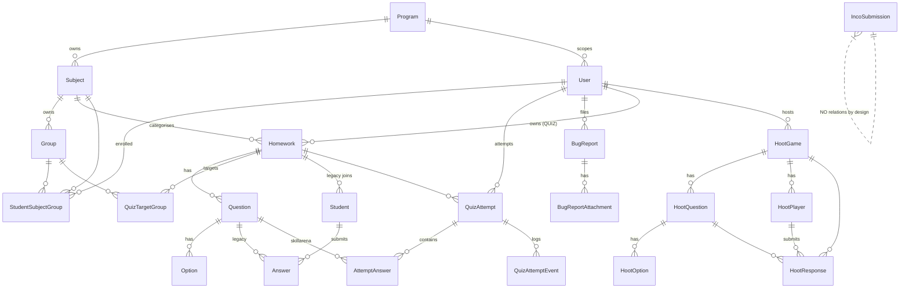

# Database Schema

Source: `prisma/schema.prisma` (636 lines) plus all 12 migrations in `prisma/migrations/`, read in full.

> **Verification limit:** I could not query the live database — `DATABASE_URL` points at a local
> `prisma dev` instance on port 51214 and a TCP probe returned `ECONNREFUSED`. Everything below is read
> from the schema and migration SQL. The two raw-SQL constraints noted as such are therefore
> **UNVERIFIED against the deployed database**.

## Model map

Six clusters: **identity/org** (Program, Subject, Group, User, StudentSubjectGroup) · **content**
(Homework, Question, Option, QuizTargetGroup) · **legacy play** (Student, Answer) · **SkillArena attempts**
(QuizAttempt, AttemptAnswer, QuizAttemptEvent) · **support** (BugReport, BugReportAttachment,
IncoSubmission) · **HootArena** (HootGame, HootQuestion, HootOption, HootPlayer, HootResponse).

## Enums

| Enum | Values | Note |
|---|---|---|
| `HomeworkMode` | LIVE, ASYNC, QUIZ | The three-systems-in-one-table switch. |
| `UserRole` | SUPER_ADMIN, ADMIN, STUDENT | Exactly one SUPER_ADMIN ever. |
| `HomeworkStatus` | DRAFT, OPEN, CLOSED | UI labels them Draft / Published / Unpublished. |
| `LivePhase` | LOBBY, QUESTION, REVEAL, FINISHED | LIVE mode only. |
| `QuestionType` | MULTIPLE_CHOICE, PARAGRAPH | PARAGRAPH is legacy-only; QUIZ mode always creates MULTIPLE_CHOICE. |
| `QuizAttemptStatus` | IN_PROGRESS, COMPLETED, FAILED | |
| `QuizAttemptEventType` | TAB_HIDDEN, WINDOW_BLUR, FAILED | **`WINDOW_BLUR` is never written** — dead value. |
| `BugReportStatus` | OPEN, IN_PROGRESS, RESOLVED | |
| `IncoCategory` | 9 values | Georgian labels in `inco-constants.ts`. |
| `IncoStatus` | NEW, IN_PROGRESS, RESOLVED | |
| `HootGameStatus` | LOBBY, QUESTION, REVEAL, LEADERBOARD, FINISHED | Note the extra LEADERBOARD phase vs LivePhase. |
| `HootQuestionType` | SINGLE_CHOICE, MULTIPLE_CHOICE, TRUE_FALSE | |

## Key models in detail

### `User` (`users`) — admins and students both
`id` cuid · `firstName`, `lastName`, `username` **@unique**, `passwordHash`, `role`, `createdAt`
· `sessionVersion Int @default(0)` · `programId String?` → Program (**onDelete: Restrict**).

- `sessionVersion` is the revocation mechanism: incremented on every password change (self-service or
  admin reset), compared against the value embedded in the JWT on every authenticated request.
- `programId` is mandatory for ADMIN/STUDENT and must be NULL for SUPER_ADMIN, enforced by a raw-SQL
  CHECK constraint `users_program_required_check` (migration `20260919090000`). **Not in schema.prisma.**
- `users_single_super_admin` — a partial unique index `ON users(role) WHERE role = 'SUPER_ADMIN'`
  (migration `20260916120100`). **Not in schema.prisma.**
- Features depending on it: all authentication, program scoping, leaderboards, bug reports, Hoot hosting.

> **Drift warning.** Both constraints above exist only as raw SQL inside migration files. `prisma migrate
> dev` compares the database against `schema.prisma`, which does not describe them, so a future
> schema change can prompt Prisma to generate a migration that drops them. Check any generated migration
> for `DROP INDEX "users_single_super_admin"` or `DROP CONSTRAINT "users_program_required_check"` before
> applying it.

### `Program` / `Subject` / `Group`
- `Program`: `name @unique`, `order`, **`groupCount Int @default(3)`** — per-program, applied when a
  subject is created. Changing it later does not retrofit existing subjects, by design.
- `Subject`: `@@unique([programId, name])` — two programs may each have their own "English". This replaced
  a global unique on name in migration `20260919090000`.
- `Group`: `@@unique([subjectId, name])`. Groups belong to a *subject*, not a program — "Group I" in
  JavaScript and "Group I" in Git are different rows.
- Cascades: Subject→Group is **Cascade**; Program→Subject and Program→User are **Restrict**.
- No delete workflow exists for any of the three, deliberately.

### `StudentSubjectGroup` — the enrolment join
`@@unique([studentId, subjectId])` is what enforces "one group per subject per student" at the database
level. `groupId` is **nullable** (migration `20260919091500`) to express "assigned to the subject, no group
decided yet" — the student sees the subject with a message but gets no quiz access. `onDelete: SetNull` on
the group.

### `Homework` — shared by all three modes
`joinCode @unique` · `creatorToken String?` (the no-login creator credential) · `livePhase`,
`currentQuestionIndex` (LIVE only) · `ownerUserId` → User **SetNull** (QUIZ only) · `subjectId` → Subject
**SetNull** (QUIZ only).

Application logic — not the schema — requires a QUIZ-mode homework to have a subject, ≥1 target group and
≥1 question before `status` may become OPEN (`setQuizStatus`, `quizzes/actions.ts:120-133`).

### `QuizAttempt` — one attempt, forever
**`@@unique([studentId, homeworkId])`** is the single real guarantee that a student cannot retake a quiz,
holding under concurrency regardless of app logic. Fields: `status`, `score`, `totalQuestions`,
`tabSwitchCount`, `failureReason`, `startedAt`, `completedAt`.

⚠ `totalQuestions` is a **snapshot taken at start** and never updated, while `score` is computed against
the quiz's *current* questions — so adding questions to a live quiz can yield `score > totalQuestions`
(displayed as e.g. "5 / 3"). See `KNOWN_ISSUES_AND_TECHNICAL_DEBT.md`.

### `AttemptAnswer` — the anti-cheat clock
`@@unique([attemptId, questionId])`. **`deadlineAt` is fixed at row creation and never moves** — the upsert
in `getOrCreateAttemptAnswer` uses `update: {}` precisely so a refresh or revisit cannot buy more time.
`isCorrect` stays NULL until final submission, so correctness is never leaked mid-quiz.

### `IncoSubmission` — anonymity by schema design
The most interesting model in the project. It has **no relation to any other model** — not to `User`, not
nullable, nothing. There is no column to join through, so no query can be extended to reveal who submitted
a message, even by someone with full database access. Only `codeHash String @unique` (SHA-256 of the
student's reference code) is stored; never the code itself. No IP, no user agent, no timestamps beyond
created/updated.

### HootArena tables
- `HootGame`: `pin @unique`, `hostId` → User **Restrict**, `status`, `currentQuestionIndex @default(-1)`.
  **No subject or group targeting** — migration `20261006120000` dropped the `subjectId` column and the
  whole `hoot_target_groups` table.
- `HootQuestion`: **`@@unique([gameId, order])`** — this is the constraint that `createHootQuestion`
  violates after a middle question is deleted (confirmed bug).
- `HootPlayer`: `@@unique([gameId, username])` — doubles as "no duplicate nicknames" *and* the idempotent
  reconnect key. `clientToken` is the bearer credential but has **no index** (lookups are by
  `(id, gameId, clientToken)`, so the PK carries them).
- `HootResponse`: `@@unique([playerId, questionId])` — the backstop behind the in-memory
  "already answered" check, and the reason a double-emit cannot double-score.

## Indexes

Present: every FK used for filtering (`users.programId`, `subjects.programId`, `groups.subjectId`,
`student_subject_groups.subjectId`/`groupId`, `homeworks.ownerUserId`/`subjectId`, `questions.homeworkId`,
`options.questionId`, `quiz_attempts.homeworkId`, `attempt_answers.questionId`,
`quiz_attempt_events.attemptId`, `bug_reports.studentId`/`status`, `inco_submissions.status`,
`hoot_games.hostId`/`status`, `hoot_questions.gameId`, `hoot_options.questionId`, `hoot_players.gameId`,
`hoot_responses.gameId`/`questionId`) plus all the unique constraints above.

Index coverage is good for the current data volume (~350 students). Candidates if it grows:
- `quiz_attempts` has no index on `(studentId, status)`; `getCumulativeLeaderboard` fetches every attempt
  for every student in a program on each call.
- `homeworks.status` is unindexed, and the dashboard filters `mode + status + OR(subject/targetGroup)`.
- `hoot_players.clientToken` is unindexed (currently fine — always queried with `id`).

## Cascade behaviour (what a delete destroys)

| Delete | Cascades to | Risk |
|---|---|---|
| `Homework` | Question → Option/Answer/AttemptAnswer, Student, QuizAttempt → AttemptAnswer/Event, QuizTargetGroup | **Deleting a quiz destroys every student's attempt and score for it.** The UI does warn. |
| `Question` | Option, Answer, AttemptAnswer | Reachable via the IDOR bugs — see the security audit. |
| `User` (student) | QuizAttempt (+children), StudentSubjectGroup, BugReport (+attachments) | Permanent score loss; UI warns. |
| `User` (admin) | — | **Blocked** by `HootGame.host` Restrict if they ever hosted a game, and `deleteAdminAccount` has no `try/catch`, so this surfaces as Next's raw error page. |
| `HootGame` | HootQuestion → HootOption, HootPlayer, HootResponse | Only allowed while status is LOBBY. |
| `Subject` | Group → memberships/targets | No delete workflow exists. |
| `Program` | — | Restrict on both Subject and User. |

Safe-by-design choices: `Homework.ownerUserId` and `Homework.subjectId` are `SetNull`, so removing an admin
or subject never destroys quizzes; `StudentSubjectGroup.groupId` is `SetNull`;
`Answer.selectedOptionId` / `AttemptAnswer.selectedOptionId` are `SetNull`.

## Data-integrity observations

1. **`totalQuestions` can disagree with reality** (above).
2. **`AttemptAnswer` rows can point at questions from other quizzes** — `selectAnswer` never validates
   `questionId` against the attempt's homework. Not score-affecting (grading iterates the real question
   set) but it is unenforced referential *meaning*.
3. **`Question.order` has no unique constraint** while `HootQuestion.order` does. The same
   `order = count()` logic therefore produces silent duplicate orders in the legacy/quiz tables and a hard
   P2002 crash in HootArena.
4. **No overall attempt deadline** — only per-question `deadlineAt`. An `IN_PROGRESS` attempt can live
   forever; nothing closes it.
5. **`Answer.pointsAwarded` is unbounded** by the schema, and `gradeAnswer` only clamps `>= 0`.

## Migration history

| # | Migration | What it did |
|---|---|---|
| 1 | `20260907153016_init` | Original Rahoot: Homework, Question, Option, Student, Answer. |
| 2 | `20260909064314_add_creator_token` | Public no-login homework creation. |
| 3 | `20260913220000_skillarena_users_and_quiz_attempts` | `User`, `QuizAttempt`, `AttemptAnswer`, `QuizAttemptEvent`; adds `QUIZ` to the mode enum. |
| 4 | `20260916030000_subjects_groups` | Subject/Group/StudentSubjectGroup/QuizTargetGroup. |
| 5 | `20260916120000_admin_roles_and_bugreports` | `SUPER_ADMIN` enum value, BugReport + attachments. |
| 6 | `20260916120100_promote_super_admin` | Promotes the earliest admin; **adds the partial unique index**. Split from #5 because Postgres forbids using a new enum value in the transaction that added it. |
| 7 | `20260918090000_session_versioning_and_inco` | `sessionVersion`; IncoSubmission. |
| 8 | `20260919090000_programs` | Program table, seeds 2 programs with fixed ids, backfills, makes `subjects.programId` NOT NULL, swaps the unique index, **adds the CHECK constraint**. Also wrongly deleted every "Group IV". |
| 9 | `20260919091500_optional_group_assignment` | `groupId` nullable + SetNull. |
| 10 | `20260921083000_program_group_count` | Adds `groupCount`, sets Front-end to 4, **restores Group IV** (guarded with `NOT EXISTS`, deterministic ids). Fixes #8's mistake. |
| 11 | `20261001120000_hootarena` | All HootArena tables, with `subjectId` + `hoot_target_groups`. |
| 12 | `20261006120000_hootarena_anonymous_players` | Drops `subjectId` and `hoot_target_groups`; swaps `HootPlayer.userId` for `username` + `clientToken`. |

Migrations 8 and 10 are worth reading as a pair: they are an honest record of a wrong assumption ("every
program has 3 groups") being made and then corrected, with comments explaining why the data restoration
was safe.
