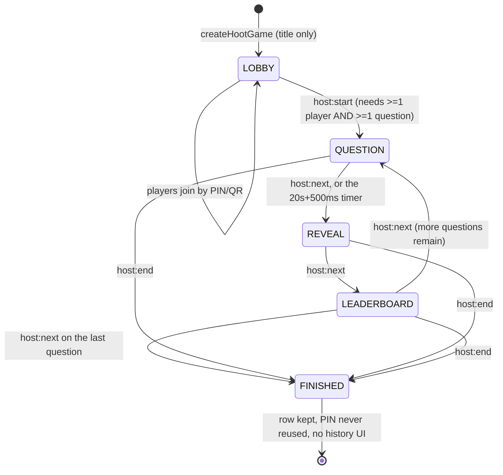

# HootArena Architecture

The newest and best-engineered subsystem: a live Kahoot-style multiplayer game, added 2026-10-06
(`ff11b96`) and reworked to anonymous join 2026-10-07 (`0f1d23d`). It is deliberately separate from the
legacy LIVE engine — its own tables, namespace, rooms, state map, scoring module and socket contract.

**Read the rework commit before trusting any comment here.** Three comments in the repo still describe the
*pre-rework* design (account-based, program-targeted) and are wrong: the HootArena section header in
`prisma/schema.prisma`, `server.ts:555-558`, and a reference in `hootarena/scoring.ts:57` to a
`hootarena/questions.ts` that does not exist.

## Access model

**No accounts, no program or group targeting.** A game is joinable by anyone with the 6-digit PIN or the QR
code — the same trust model as a legacy LIVE homework. The admin side stays fully account-based: `hostId`
anchors "a regular Admin manages games they created; the Super Admin manages any"
(`canAdminManageGame`, `src/lib/hootarena/access.ts:17`).

PIN generation (`src/lib/hootarena/pin.ts`): `crypto.randomInt(100000, 1000000)` — cryptographically
secure, not `Math.random()`, because the PIN is the only access credential — checked for uniqueness against
**every game ever created** (not just active ones) so a mistyped PIN from a just-ended game cannot land you
in an unrelated new one. 20 retries, then throws.

Player identity is `(playerId, clientToken)`: a 32-char random token stored in the `__session` envelope
under `hootPlayers[gameId]`, verified on every socket join against `findFirst({id, gameId, clientToken})`.

## Data model

```
HootGame   pin @unique · hostId → User (Restrict) · status · currentQuestionIndex (-1)
  ├── HootQuestion   @@unique([gameId, order]) · type: SINGLE_CHOICE|MULTIPLE_CHOICE|TRUE_FALSE
  │     └── HootOption   text · isCorrect · order
  ├── HootPlayer    @@unique([gameId, username]) · clientToken · score · connected
  └── HootResponse  @@unique([playerId, questionId]) · selectedOptionIds String[] · isCorrect · pointsAwarded
```

Two constraints carry real weight:
- `@@unique([gameId, username])` is simultaneously the "no duplicate nicknames" rule **and** what makes
  reconnect idempotent.
- `@@unique([playerId, questionId])` is the final backstop behind the in-memory already-answered check, so
  a double-emit or a server restart can never double-score.

## Lifecycle



Note the extra **LEADERBOARD** phase that legacy LIVE does not have, so the board is a deliberate beat
between questions rather than part of the reveal.

Editing (title, questions, delete) is permitted **only while LOBBY** —
`requireHootGameEditable` redirects otherwise.

## Event flow, end to end

### Join
```
Browser                          Server                               DB
   │ POST joinHootGame(gameId)      │                                   │
   │───────────────────────────────►│ rate-limit 10/min (hoot_rl cookie) │
   │                                │ case-insensitive nickname check ──►│
   │                                │ create HootPlayer ────────────────►│
   │                                │ set __session.hootPlayers[gameId]  │
   │◄── redirect /hootarena/play/id─│                                   │
   │ socket: player:join {gameId, playerId, clientToken}                 │
   │───────────────────────────────►│ findFirst({id,gameId,clientToken})►│
   │                                │ game must not be FINISHED          │
   │                                │ connected = true ─────────────────►│
   │                                │ kick any previous socket for this playerId
   │                                │ socket.join(`hoot:{gameId}`)
   │◄── ack(true) ──────────────────│
   │◄── lobby:update ───────────────│ (LOBBY only)
   │◄── restoreHootStateForSocket ──│ replays the current phase
```

### Answering
`player:answer {gameId, questionId, selectedOptionIds}` → the server checks, **in order**:
`socket.data.playerId` exists · `socket.data.gameId === gameId` · status is `QUESTION` ·
`currentQuestionPayload.questionId === questionId` · `!answeredPlayerIds.has(playerId)` ·
`elapsedMs <= 20 s + 500 ms` (independent of phase) · the question really belongs to this game.

Then: option ids are de-duplicated and filtered against the question's real options, correctness is
`isSelectionCorrect(clean, correctIds)`, points are `computeHootPoints({isCorrect, elapsedMs})`,
`answeredPlayerIds.add(playerId)` happens **before** the await, and a `$transaction` creates the response
and increments the player's score.

## Scoring (`src/lib/hootarena/scoring.ts`)

```
points = isCorrect ? round(1000 × (0.5 + 0.5 × (1 − clamp(elapsedMs, 0, 20000) / 20000))) : 0
```

- Instant correct = 1000; correct at the buzzer = 500; incorrect, unanswered, partial and over-selected
  all = 0.
- `elapsedMs` is clamped into `[0, timeLimit]`, so clock skew or a malformed payload cannot inflate or
  crash scoring.
- Deterministic in `(isCorrect, elapsedMs)` only — nothing the client claims about itself can influence it.
- **No partial credit**, by explicit product decision: `isSelectionCorrect` requires exact set equality
  (same length, every id in the correct set, no duplicates). A repeated option id is rejected rather than
  silently de-duplicated into a match.

These are pure functions, which is why they are the only unit-tested code in the project —
`e2e/hootarena-scoring.mjs`, **18/18 passing** (verified this session).

## Privacy split — enforced by types, not discipline

| Payload | Recipient | Contains |
|---|---|---|
| `phase:reveal` | room-wide (students) | `questionId`, `answeredCount`, `totalPlayers` — **no correct answer, no per-option counts** |
| `phase:reveal:host` | host sockets only | full per-option distribution with counts, percentages and `isCorrect` |
| `leaderboard:you` / `finished:you` | one player | own score, `pointsThisRound`, top 3 (`username` + `score` only), `youAreInTop3` |
| `leaderboard:host` / `finished:host` | host sockets only | full ranked board including internal `playerId`s |

`HootPublicLeaderboardEntry` deliberately has no `playerId` field, so a student's client **cannot** receive
another player's database id — which is why `HootTop3` keys its list by `username`. The slim student
payload is always *derived* from the canonical admin one by `toStudentRevealPayload` (`server.ts:709`), so
the two shapes cannot drift apart.

## Concurrency and race handling — the strongest code in the repo

Five distinct races are handled explicitly, each with a comment explaining the reasoning:

1. **Double reveal.** The 20 s timer and a manual "Reveal answer" click can both enter
   `revealHootQuestion` while `status` still reads `QUESTION`. The fix is to flip
   `state.status = "REVEAL"` **synchronously, before the first `await`** (`server.ts:725`), so the second
   caller fails the guard instead of racing through the DB round trip.
2. **Out-of-order reconnects.** `player:join` does DB work before touching `playerSockets`, so two rapid
   reconnects can resolve in either order. A monotonic `hootJoinCounter` is captured synchronously at call
   start (`mySeq = ++hootJoinCounter`) and compared against `playerJoinSeq`; a stale older join is still
   ack'd true but is not allowed to overwrite the registered socket with a dead id.
3. **Duplicate sessions.** A fresh join for a `playerId` already connected emits
   `kicked {reason: "duplicate-session"}` to the old socket and disconnects it, keeping exactly one live
   socket per player.
4. **Double-submitted answers.** `answeredPlayerIds.add()` before the await, plus the DB unique constraint
   as the backstop.
5. **Late answers.** A deadline check independent of phase, closing the window between the timer firing
   and the phase flip completing.

## Reconnect handling

Both clients re-run their join on **every** `connect` event, not just at mount:
```tsx
if (socket.connected) join();
socket.on("connect", join);
```
`player:join` is idempotent and phase-aware, so a reconnect is effectively "tell me the current
authoritative state". `restoreHootStateForSocket` then replays:
- **QUESTION** — resends the question *and*, for a player, replays their stored `answer:you` so the UI shows
  "locked in" rather than offering answerable tiles again.
- **REVEAL** — host gets the full distribution, player gets the slim payload.
- **LEADERBOARD / FINISHED** — needs a fresh per-recipient DB read, since "your score and whether you're in
  the top 3" is recipient-specific.

`e2e/hootarena-reconnect.mjs` covers this with 14 checks using `BrowserContext.setOffline` to drop the real
WebSocket transport, including "offline exactly when the host advanced" and "a player's own reconnect never
kicks themselves". **This is the one area where the legacy LIVE engine was never fixed** — see
`KNOWN_ISSUES_AND_TECHNICAL_DEBT.md`.

## Disconnect and host behaviour

`disconnect` (`server.ts:1146`): a host socket is removed from `hostSocketIds` and **game state is never
torn down** — it waits for any host to reconnect. A player's socket is removed only if it is still the
registered one, then `connected: false` is persisted and the lobby rebroadcast. `connected` is soft
presence for the host's player list, never a gate on answering.

`broadcastHootLobby` short-circuits past LOBBY: it refreshes `totalPlayers` with a cheap `count()` but
skips the full query and room-wide broadcast, because no one renders the roster mid-game. The comment notes
this matters specifically for a flaky-wifi classroom where reconnects would otherwise trigger a broadcast
storm.

## Server-restart recovery

`recoverHootStates()` runs before the HTTP server starts listening. It rebuilds `hootStates` for games in
`QUESTION`/`REVEAL`/`LEADERBOARD` from `HootGame.status` + `currentQuestionIndex`. Because elapsed time is
never persisted, a game caught mid-`QUESTION` is deliberately recovered into **REVEAL** rather than
guessing a new deadline — the same policy as the legacy engine.

## Admin surface

`/admin/hootarena` (list, filtered by manageable games) → `/admin/hootarena/new` (title only) →
`/admin/hootarena/[id]` (PIN, QR, join link, question CRUD with up/down reorder) →
`/admin/hootarena/[id]/host` (the live control panel).

Host panel phases: lobby (PIN + player count + Start, disabled unless ≥1 player and ≥1 question) →
question (timer, live answered count, "Reveal answer") → reveal (per-option bars with counts/percentages,
correct answer marked, unanswered count) → leaderboard (full board) → finished. "End game early" is
confirmed with `window.confirm`.

## Known issues (detail in `KNOWN_ISSUES_AND_TECHNICAL_DEBT.md`)

1. **`createHootQuestion` can crash with P2002.** `order = count(gameId)` while `deleteHootQuestion` never
   renumbers: orders `0,1,2` → delete `1` → rows `{0,2}`, `count = 2` → new question gets `order = 2`,
   violating `@@unique([gameId, order])`. Unhandled, so it surfaces as Next's raw error page.
2. **IDOR in `updateHootQuestion` / `deleteHootQuestion`** — `questionId` is never checked against
   `gameId` (the sibling `moveHootQuestion` does it correctly).
3. **Players can join a game already in progress.** Only `FINISHED` is blocked, so a late joiner enters
   with score 0 and inflates `totalPlayers`, changing the reveal's unanswered count mid-game.
4. **The host's in-question "answered / total" uses the stale lobby snapshot** (`players.length`), because
   `lobby:update` stops broadcasting past LOBBY. The reveal screen uses the server's accurate
   `totalPlayers`, so the two disagree when someone joins late.
5. **`hootStates` entries are never deleted**, even after FINISHED — a slow memory leak over long uptime.
6. **Three stale comments** describing the pre-rework account-based design.
7. **No theme toggle** on any `/hootarena/*` route.
8. **No history UI.** Finished games and their responses persist with no surface to browse them — stated as
   a deliberate scope decision, but it means the data is collected and never shown.
